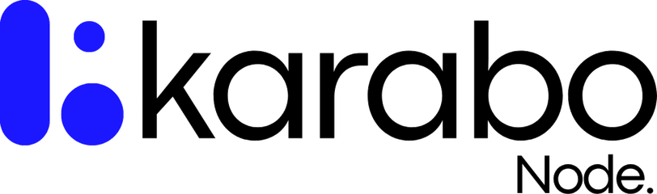

<p align="center">
  <a href="https://www.karabonode.co.za">
    <picture>
      <source media="(prefers-color-scheme: dark)" srcset="assets/karabonode-logo-dark.png">
      
    </picture>
  </a>
</p>

# ☁️ Cloud Foundations: Beginner Labs

> **KaraboNode** · Learn it. Build it. Prove it.
> Six small labs that take you from "what is Azure?" to putting a real business online. Free to start, always.

---

## The story

**Mzansi Threads** is a small clothing brand from Soweto. Right now they sell through Instagram DMs and a WhatsApp catalogue. Orders are growing, and the owner, Lerato, wants a proper online presence: a website with their product photos, running on the cloud, **without the bill getting out of hand**.

Lerato has hired you as their **junior cloud administrator**. You've never used Azure before. That's fine: each lab teaches you one building block, and in the last lab you put them all together and get Mzansi Threads online.

## The series

Each lab is small (about an hour) and builds on the one before.

| Lab | What you'll do | Time | Cost |
|---|---|---|---|
| [01 · Take a tour of Azure](labs/01-azure-tour/) | Find your way around the portal, regions and resource groups | ~1 h | Free |
| [02 · Control costs first](labs/02-cost-control/) | Set a budget alert and estimate costs *before* building | ~1 h | Free |
| [03 · Store files in the cloud](labs/03-storage/) | Keep product photos in a storage account and share one safely | ~1 h | Cents |
| [04 · Your first virtual machine](labs/04-virtual-machines-networking/) | Run a web server on a VM and learn how networking lets people reach it | ~1.5 h | Cents (delete it!) |
| [05 · Who can do what](labs/05-identity-governance/) | Give a contractor read-only access and set rules Azure enforces | ~1 h | Free |
| [06 · 🏁 Capstone: Mzansi Threads online](labs/06-capstone-mzansi-threads-online/) | Put it all together: a live website, budgeted, governed and documented | ~3 h | Cents |

```
 01 Tour ──► 02 Costs ──► 03 Storage ──► 04 VMs & networking ──► 05 Access & rules ──► 06 🏁 Capstone
```

## Which exam this prepares you for

These labs are aligned to **Microsoft Azure Fundamentals (AZ-900)**. They don't replace studying, but you'll have *done* what the exam asks about.

| AZ-900 area | Where you practise it |
|---|---|
| Cloud concepts (IaaS, PaaS, SaaS, shared responsibility, pricing models) | Labs 01, 04, 06 |
| Azure architecture (regions, subscriptions, resource groups) | Lab 01 |
| Compute and networking (VMs, VNets, NSGs) | Lab 04 |
| Storage (accounts, redundancy, access tiers) | Lab 03 |
| Identity, access and security (Entra ID, RBAC) | Lab 05 |
| Cost management (budgets, pricing calculator, tags) | Lab 02 |
| Governance (Azure Policy, resource locks) | Lab 05 |

> Exam details change. Always check the official AZ-900 page on Microsoft Learn before booking.

## Jobs this points towards

**Cloud Support Associate** → **Junior Cloud Administrator** → **Cloud Administrator** (with the intermediate labs)

## How to use these labs

1. Do them **in order**: each one uses something from the last.
2. Create your own GitHub repo called `my-cloud-foundations` (it's free). After each lab, add a short note and a screenshot to a folder for that lab. By Lab 06 you have a portfolio, not just a certificate.
3. Stuck? That's normal. Read the step again, check the hint, then ask in the KaraboNode community.

## What you need

- A computer with a modern web browser
- An Azure subscription. Options:
  - **Azure for Students** (no credit card, if you're a student)
  - **Azure free account** (needs a card for identity checks, includes free credit)
- About an hour per lab

> 💰 **Golden rule:** every lab ends with a **clean-up** step. Do it. Lab 02 also shows you how to get an email *before* you spend too much.

## When you're done

Move on to the intermediate **Azure Networking Lab**, then the **Azure Secure Web Application**. Both are coming soon on the KaraboNode site.

---

💬 Community: https://www.karabonode.co.za/community/ · 🐛 Found a mistake? [Open an issue](../../issues)
**Licence:** Content CC BY 4.0 · Code MIT · Part of [KaraboNode](https://www.karabonode.co.za)
